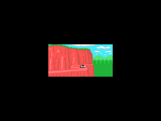

<!--
SPDX-FileCopyrightText: 2026 Mikey Sklar for Adafruit Industries
SPDX-License-Identifier: MIT
-->

# CircuitPython MSX

MSX1 cartridge games on an Adafruit Fruit Jam, running under stock CircuitPython. The emulator
(Z80, TMS9918A video, AY-3-8910 sound, 8255 PPI, slots, MegaROM mappers, Konami SCC) is
written for this project (MIT) and compiled into a native `.mpy` module like the other ports
in this repo. The open source [C-BIOS](http://cbios.sourceforge.net/) is built in, so no
copyrighted BIOS is needed.

Runs at full speed (59.9 fps) on the board. Board screenshots match the host emulator
byte for byte.



## What you need

| part | notes |
|---|---|
| Adafruit Fruit Jam | RP2350 |
| CircuitPython 11.0.0-alpha | the `.mpy` is built for this version |
| HDMI monitor | 256x192 picture in a 320x240 frame, doubled to 640x480 |
| headphones or speaker | optional |
| a `.rom` / `.mx1` / `.mx2` MSX1 cartridge image | not included |
| `msx.rom` BIOS | optional, a real 32 KB MSX1 BIOS used instead of C-BIOS |

## Setup

With the [launcher](../launcher) (recommended): `msx.mpy` goes in `/emus` on the SD card
next to `emu_msx.py`, ROMs go in `/cart`. MSX games show up in the menu as "MSX".

Standalone, one game per card: back up your `CIRCUITPY` drive first, `code.py` will be
replaced.

```sh
cp -r fruitjam-arcade/ports/msx/CIRCUITPY/* /Volumes/CIRCUITPY/
cp MyGame.rom /Volumes/CIRCUITPY/      # or the root of the SD card
circup install adafruit_fruitjam relic_usb_host_gamepad   # sound, gamepad
```

## BIOS

- **C-BIOS 0.29a** (MSX1, international, 60 Hz) is compiled into `msx.mpy`. It shows its logo
  for two seconds, then starts the cartridge. It runs cartridge games; it has no MSX-BASIC,
  so cartridges that are BASIC programs do not start. C-BIOS is not MIT: it is under a
  BSD-style license that allows redistribution with its notice, see
  [src/cbios/LICENSE.txt](src/cbios/LICENSE.txt).
- **Your own BIOS**: put a dump of a real 32 KB MSX1 main ROM next to the games as `msx.rom`
  (it is hidden from the launcher menu). It is used instead of C-BIOS.

## Cartridges and mappers

| ROM | how it is mapped |
|---|---|
| up to 16 KB | at $4000 (or $8000 if its start address is there), mirrored |
| 32 KB | $4000-$BFFF |
| 48 / 64 KB | from $0000 if the "AB" header is at offset $4000, else from $4000 |
| over 64 KB (MegaROM) | Konami, Konami SCC (with SCC sound), ASCII8 or ASCII16 |

The MegaROM mapper is guessed by counting `LD (nnnn),A` writes to each mapper's bank
registers, the same heuristic openMSX and blueMSX use when a ROM is not in their database.
It can guess wrong. With the launcher, fix it per game in `/cart/<rom name>.fruitjam.cfg`:

```
mapper = ascii8          # plain | konami | scc | ascii8 | ascii16
```

## Controls (launcher, arcade pad)

Joystick port 1 plus the keys games ask for most. C is a shift; tapped alone it is N.

| Button | alone | with C held |
|---|---|---|
| D-pad | joystick 1 + cursor keys | 1 / 2 / 3 / 4 (Up / Down / Left / Right) |
| A (D10) | trigger A + Space | F2 |
| B (A2) | trigger B + M | F3 |
| Start (D6) | F1 | F4 |
| Start2 (D7) | Return | F5 |
| Coin (A5) | 1 | Esc |
| C (A1) | N | |

Start + Coin held for a second goes back to the menu. Per game, `dpad = joy` or
`dpad = keys` in the `.fruitjam.cfg` sends the D-pad to only one of them, and
`keys = A:SPACE START:F5 ...` changes the key of any button. See
`launcher/sd/emus/emu_msx.py`.

The standalone `code.py` uses a USB gamepad and the three Fruit Jam buttons; its `CONTROLS`
section has the table.

## Speed (measured on the board)

```
MSX core on a Fruit Jam, launcher, 320x240 RGB565
+------------------------------------------+------+------------------+
| ROM                                      | fps  | emu+input ms     |
+------------------------------------------+------+------------------+
| World Rally demo (48 KB plain)           | 59.9 | 6.9 - 9.6        |
| Viboritas (CVBasic, 8 KB plain)          | 59.9 | 7.9 - 8.3        |
| Portraits slideshow (256 KB ASCII8)      | 59.9 | 5.4 - 6.4        |
| CVBasic bank demo (128 KB Konami, Z80    | 59.9 | 8.6 - 11.8       |
|   busy all frame)                        |      |                  |
+------------------------------------------+------+------------------+
A frame lasts 16.7 ms.
```

## Build the `.mpy` yourself

```sh
cd fruitjam-arcade/ports/msx/src
make MPY_DIR=../../../../circuitpython ARCH=armv7emsp     # needs arm-none-eabi-gcc, pyelftools
cp msx.mpy ../CIRCUITPY/lib/
```

Host tests (any C compiler; downloads the Z80 exercisers and free homebrew, builds CVBasic
demo carts for MSX):

```sh
./get_testroms.sh
./run_tests.sh
```

## How it works

- `src/z80.h` is the CPU (shared design with `../coleco`, passes zexdoc and zexall),
  `src/msx.h` the machine: slots and memory map, VDP, PSG, SCC, PPI, mappers.
  `src/msx.c` wraps it as a CircuitPython native module.
- Memory reads and writes go through a table of eight 8 KB pointers rebuilt on every slot
  or bank switch; mapper registers, SCC registers and empty slots take a slow path.
- The VDP draws each scanline in one go, then the CPU runs that line (228 cycles plus the
  MSX's extra wait state on every M1 cycle). The frame interrupt drives the Z80 INT line.
- Sound: AY-3-8910 (3 tones, noise, envelope), SCC (5 wavetable channels) and the key click
  are mixed into a looping `audiocore.RawSample` on the TLV320 DAC.
- All buffers are Python-owned. The native code allocates nothing.

## Known issues

- No MSX-BASIC with C-BIOS (BASIC cartridges and tape/disk software do not run).
- MSX1 only: no MSX2 VDP (V9938), no disk drive, no MSX-MUSIC/FM-PAC, no tape.
- No SRAM cartridges (ASCII8/16 with battery RAM), no other mappers (Konami SCC+, R-Type,
  Game Master 2, Harry Fox, ...).
- The mapper guess has no ROM database; some MegaROMs need `mapper =` in their cfg.
- Only joystick port 1 is mapped. Keyboard input is limited to the keys in the table.
- VDP register changes in the middle of a scanline show one line late.

## License

MIT for this port's code. C-BIOS (`src/cbios/`, and the arrays generated from it in
`src/cbios.h`) is under the C-BIOS license in `src/cbios/LICENSE.txt`. No game ROMs are
included.
