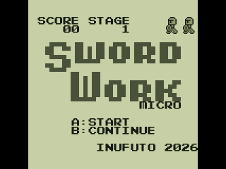

# CircuitPython Watara Supervision

Watara Supervision games on an Adafruit Fruit Jam, running under stock CircuitPython. The
emulator is written for this repo (MIT): a 65C02 core shared with the Lynx port and a
Supervision core written from Kevin Horton's public reverse engineering notes. It is
compiled into a native `.mpy` module like the Game Boy port in the parent directory and runs
from the Fruit Jam Arcade launcher (`../launcher`).

Runs on the board at full speed (61 fps). See [NOTES.md](NOTES.md) for what has been
verified.



## What you need

| part | notes |
|---|---|
| Adafruit Fruit Jam | RP2350 |
| CircuitPython 11.0.0-alpha | the `.mpy` is built for this version |
| the launcher | `../launcher`, SD card with `/emus` and `/cart` |
| HDMI monitor | 160x160 picture at 1.5x (240x240), centered |
| headphones or speaker | optional |
| a `.sv` cart image | not included, no BIOS needed |

## Setup

Copy `CIRCUITPY/lib/supervision.mpy` and `../launcher/sd/emus/emu_supervision.py` into
`/emus` on the launcher's SD card, and the game into `/cart`. Supervision games must end in
`.sv`: many dumps are named `.bin`, but the launcher treats `.bin` as an Atari 2600 cart, so
rename them.

Free games to try: inufuto's Supervision games (Ascend, SwordWork Micro, Cracky, Lift and 19
more) from <http://inufuto.web.fc2.com/8bit/>; `src/get_testroms.sh` downloads them. Our own
test cart is `src/testcart/svtest.sv`.

## Controls

| pad | Supervision |
|---|---|
| D-pad | D-pad |
| A (D10) | A |
| B (A2) | B |
| C (A1) | Select |
| Start (D6) | Start |
| Start 2 (D7) | Select |
| Coin (A5) | not used, Start + Coin held 1 s goes back to the menu |
| Button 1 | picture: 1.5x blended, 1.5x sharp, 1x |
| Button 3 | palette: green LCD, grey, amber, blue, pea soup |

Picture and palette are remembered per game in its `.fruitjam.cfg`.

## Speed

Measured on the Fruit Jam (CircuitPython 11.0.0-alpha.1), launcher's own counter:

| game | fps | emu + input ms per frame |
|---|---|---|
| SwordWork Micro (title) | 61.0 | 10.3 |
| svtest (redraws every frame, sample audio) | 61.0 | 12.1 |
| SwordWork Micro gameplay (core only, REPL) | | 10.05 average, 18.4 worst |

The frame budget at 61.04 Hz is 16.4 ms.

## Build the `.mpy` yourself

Same toolchain as the parent project (arm-none-eabi-gcc, pyelftools):

```sh
cd fruitjam-arcade/ports/supervision/src
make MPY_DIR=../../../../circuitpython ARCH=armv7emsp
cp supervision.mpy ../CIRCUITPY/lib/
```

Host tests (any C compiler, downloads free test programs):

```sh
cd fruitjam-arcade/ports/supervision/src
make -f Makefile.host
./get_testroms.sh
./run_tests.sh
```

The test cart needs cc65 (`ca65`, `ld65`) to rebuild:

```sh
cd src/testcart && ca65 --cpu 65C02 svtest.s && ld65 -C svtest.cfg -o svtest.sv svtest.o
```

## Licence

MIT, see the SPDX headers. The hardware description comes from Kevin Horton's
"Supervision Reverse Engineering Notes" (Unlicense). No code from other emulators.
